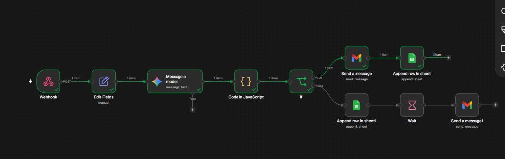
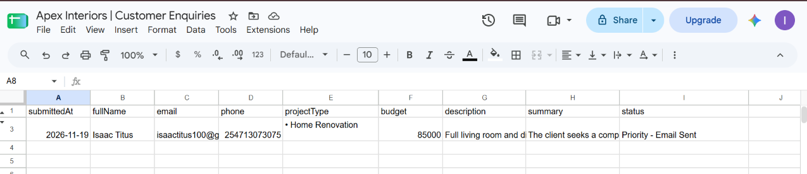
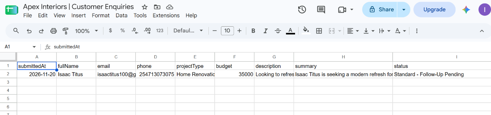
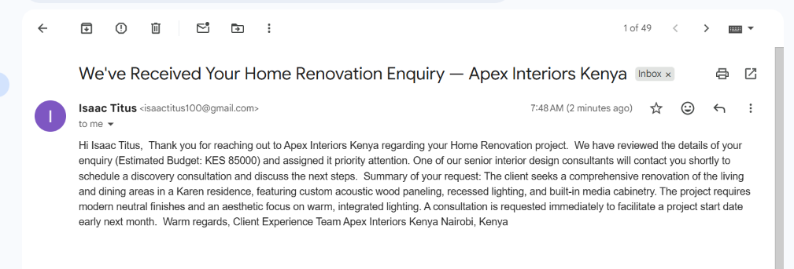
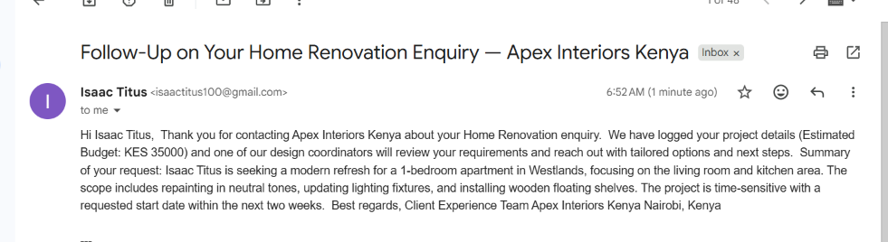

# Apex Interiors Kenya — AI-Powered Customer Enquiry & Follow-Up System

An automated lead intake, AI summarization, and routing workflow built in **n8n**, integrating **Tally Forms**, **Google Gemini**, **Google Sheets**, and **Gmail**.

## Workflow Overview
1. **Webhook Trigger:** Listens for incoming `POST` requests from the Tally project enquiry form.
2. **Data Normalization (`Edit Fields`):** Extracts and standardizes customer details (`fullName`, `email`, `phone`, `projectType`, `budgetInput`, `description`, `submittedAt`).
3. **AI Summarization (`Google Gemini`):** Analyzes the enquiry and generates a concise 2–3 sentence project summary in strict JSON format.
4. **Validation & Parsing (`Code in JavaScript`):** Strips formatting, parses Gemini's JSON output, and validates the numeric KES budget.
5. **Conditional Routing (`IF` Node):** Splits leads based on estimated budget (`> 50,000 KES` vs. `<= 50,000 KES`):
   - **High-Budget Leads (`> 50,000 KES`):** Sends an immediate priority email via Gmail and logs the lead to the `High-Budget Leads` tab (`Priority - Email Sent`).
   - **Standard Leads (`<= 50,000 KES`):** Logs the lead to the `Standard Leads` tab (`Standard - Follow-Up Pending`), waits **2 hours**, and sends a delayed follow-up email.

## Test Execution Proof

### 1. End-to-End n8n Workflow Execution

### 2. High-Budget Lead Sheet Log (`85,000 KES`)

### 3. Standard Lead Sheet Log (`35,000 KES`)

### 4. Priority Confirmation Email (`85,000 KES`)

### 5. Delayed Follow-Up Email (`35,000 KES`)

